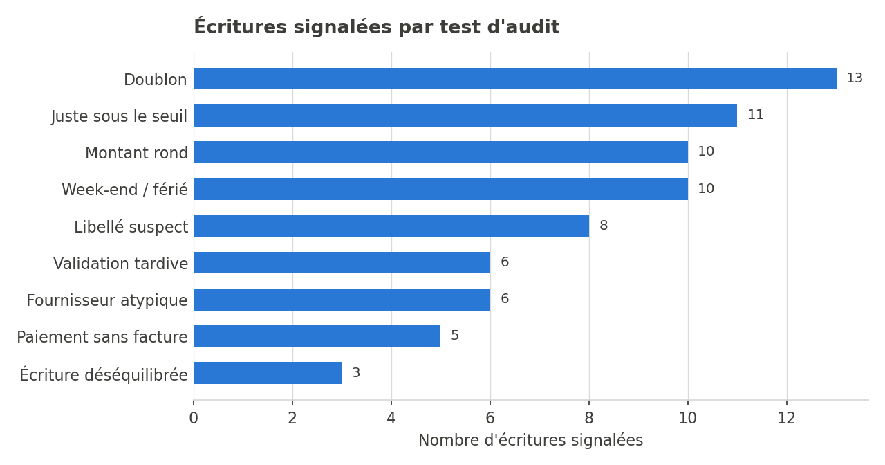
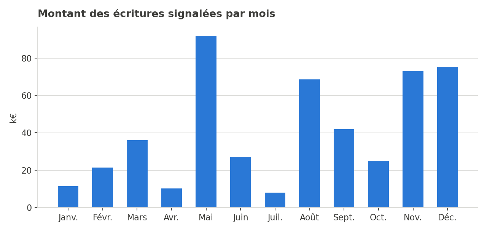
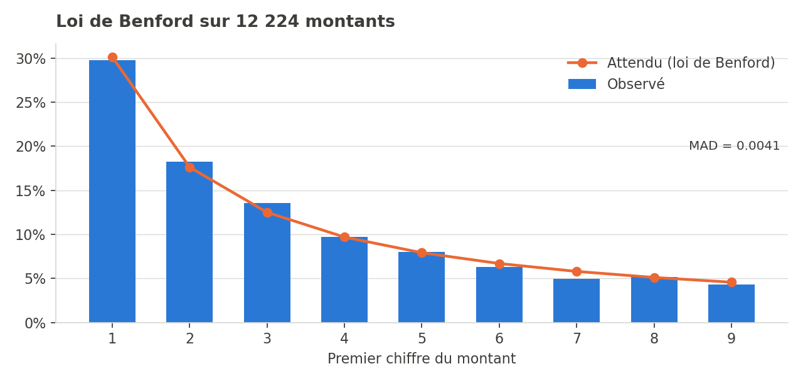

# Audit du FEC avec Python : détection d'anomalies comptables

Outil d'analyse automatisée d'un **Fichier des Écritures Comptables (FEC)** reproduisant la démarche d'un auditeur : contrôle de l'intégrité du fichier, tests ciblés sur les écritures à risque, loi de Benford et score de risque fondé sur le seuil de signification.

> ⚠️ **Données 100 % fictives.** Le FEC est généré par le script `generer_donnees.py` (PME de services fictive, exercice 2025). Aucune donnée réelle d'entreprise n'est utilisée.

## Résultats

| Indicateur | Valeur |
|---|---|
| Écritures analysées | 4 826 (12 239 lignes) |
| Écritures signalées pour revue | **72 (1,5 %)** |
| Anomalies cachées retrouvées (rappel) | **100 %** (69/69) |
| Alertes justifiées (précision) | **95,8 %** (69/72) |
| Trous de numérotation détectés | 7/7 |
| Seuil de signification | 45 500 € (1 % du CA) |

L'outil réduit l'échantillon à examiner de **4 826 à 72 écritures**, sans laisser passer d'anomalie.







## Contexte

En audit légal, la norme **NEP 240 / ISA 240** impose de tester les écritures comptables pour détecter les risques de fraude, notamment le contournement des contrôles par la direction. Le support de ce travail est le **FEC**, fichier normé (art. A47 A-1 du Livre des procédures fiscales) que toute entreprise doit remettre à l'administration fiscale lors d'un contrôle.

Pour mesurer objectivement l'efficacité de l'outil, **76 anomalies de 10 types** ont été cachées dans le FEC. Leur liste (`data/anomalies_injectees.csv`) sert uniquement de corrigé : les tests ne la consultent jamais.

## Démarche

| Étape | Script | Rôle |
|---|---|---|
| 1 | `generer_donnees.py` | Génère le FEC fictif (18 colonnes réglementaires, 6 journaux, lettrage, TVA, paie, emprunt) et le corrigé des anomalies |
| 2 | `controles_conformite.py` | 13 contrôles d'intégrité du FEC |
| 3 | `tests_audit.py` | 9 tests d'audit sur les écritures à risque |
| 4 | `score_risque.py` | Score de risque, seuil de signification, tableau de bord et graphiques |

### Contrôles de conformité (étape 2)

Structure réglementaire, champs obligatoires, format des dates, dates hors exercice, cohérence des dates de validation, validité des montants, **équilibre de chaque écriture**, équilibre global, **continuité de la numérotation**, chronologie, lettrage soldé, comptes de tiers renseignés, **compte d'attente soldé à la clôture**.

### Tests d'audit (étape 3)

| Test | Risque visé |
|---|---|
| Écritures le week-end ou un jour férié | Saisie hors du cadre normal de contrôle |
| Montants ronds (multiples de 1 000 €) | Estimations ou écritures fictives |
| Doublons (même pièce, même tiers, même montant) | Double paiement |
| Factures juste sous le seuil d'autorisation | Fractionnement pour contourner une approbation |
| Validation plus de 30 jours après la date | Manipulation du résultat après clôture (cut-off) |
| Libellés vagues (« divers », « à justifier »…) | Écritures non documentées |
| Fournisseurs rares payés immédiatement | Fournisseur fictif |
| Paiements fournisseurs non lettrés | Paiement sans facture |
| Loi de Benford (1 et 2 premiers chiffres, MAD de Nigrini, khi²) | Manipulation massive des montants |

### Score de risque (étape 4)

Chaque écriture signalée reçoit des points selon la gravité des tests déclenchés (de 2 à 5 points), majorés selon son montant par rapport au **seuil de signification** (1 % du CA), au **seuil de planification** (75 %) et au **seuil des anomalies insignifiantes** (5 %). Elle est ensuite classée en risque **élevé, moyen ou faible**.

## Livrables

- `resultats/01_conformite.xlsx` : synthèse des 13 contrôles et détail de chaque anomalie
- `resultats/02_tests_audit.xlsx` : synthèse des tests, détail par test et analyse de Benford avec graphique
- `resultats/03_rapport_audit.xlsx` : tableau de bord, écritures classées par score, méthodologie
- `resultats/graphiques/` : graphiques au format PNG

## Utilisation

```bash
pip install -r requirements.txt
python lancer_audit.py
```

Les données sont reproductibles (graine aléatoire fixe). Les seuils (seuil d'autorisation, délai de validation, mots-clés…) sont des paramètres modifiables en tête de chaque script. Le script `controles_conformite.py` et les tests s'appliquent à tout FEC respectant la norme.

## Structure

```
├── data/
│   ├── 999999999FEC20251231.txt     FEC fictif (format réglementaire)
│   └── anomalies_injectees.csv      corrigé des anomalies cachées
├── resultats/                       rapports Excel et graphiques
├── generer_donnees.py
├── controles_conformite.py
├── tests_audit.py
├── score_risque.py
├── lancer_audit.py                  lance les 4 étapes
└── requirements.txt
```

## Outils

Python · pandas · NumPy · SciPy · Matplotlib · XlsxWriter

## Pistes d'amélioration

- Interface web avec Streamlit pour charger un FEC et explorer les alertes
- Détection d'anomalies par apprentissage automatique (Isolation Forest)
- Tests complémentaires : séparation des tâches, écritures inversées, analyse par utilisateur

## Auteur

**Zakaria El Idrissi**, diplômé de Brest Business School (programme grande école), en préparation de l'expertise comptable.
[LinkedIn](https://www.linkedin.com/in/zakaria-el-idrissi-bbs)
